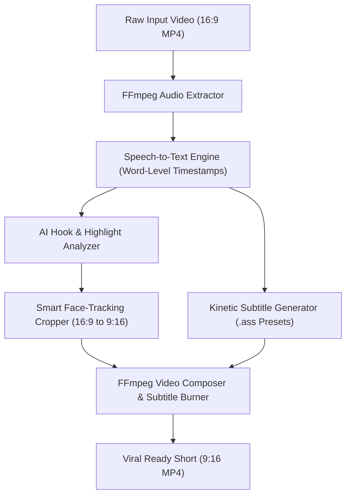

# ClipForge 🎬⚡

<p align="center">
  <a href="https://github.com/soumyadeepmagnusx/clipforge/actions/workflows/ci.yml">
    
  </a>
  
  <a href="https://github.com/soumyadeepmagnusx/clipforge/blob/main/LICENSE">
    
  </a>
  
  
</p>

<p align="center">
  <strong>Open-Source AI Video Repurposing & Kinetic Caption Engine.</strong><br>
  Automatically turn long-form landscape videos (podcasts, interviews, talks) into viral 9:16 vertical shorts with smart face-tracking and animated karaoke subtitles.
</p>

---

## 🌟 Why ClipForge?

Content creators and media teams spend hours manually clipping long videos, reframing them to vertical 9:16 for TikTok/Reels/Shorts, and keyframing subtitles. Commercial tools charge **\$20–\$50/month** for this.

**ClipForge** is a local-first, open-source pipeline that does it all in seconds:
1. 🎯 **Viral Hook Detection**: Analyzes transcript sentiment, hook density, and speech pace to isolate the most engaging 30–60 second segments.
2. 👤 **Smart Face-Centric Cropping**: Uses OpenCV computer vision face detection with temporal smoothing to dynamically center speakers when converting landscape (16:9) to vertical (9:16).
3. ✨ **Kinetic Karaoke Subtitles**: Generates word-by-word highlighted captions with custom animated presets (**Hormozi**, **Neon**, **Minimal**, **Classic**) burned directly onto the video.
4. 🐳 **Zero-Config Docker Setup**: Ready-to-use Docker container with FFmpeg and computer vision libraries pre-bundled.
5. 🔒 **Local & Privacy-Preserving**: Runs 100% locally on your machine with FFmpeg and local or cloud AI models.

---

## 🏗️ Architecture



---

## 🚀 Quickstart

### Option 1: Local Installation

#### Prerequisites
- Python 3.10+
- [FFmpeg](https://ffmpeg.org/download.html) installed and available on your PATH.

#### Installation
```bash
git clone https://github.com/soumyadeepmagnusx/clipforge.git
cd clipforge
pip install -r requirements.txt
```

---

### Option 2: 1-Command Docker Run (Zero Setup)

Don't want to install FFmpeg or Python dependencies manually? Run ClipForge in Docker:

```bash
# Build the Docker image
docker build -t clipforge .

# Process a video with 1 command
docker run --rm -v ${PWD}:/workspace -w /workspace clipforge process sample.mp4 --preset hormozi
```

---

## 🖥️ Usage

### 1. Command Line Interface (CLI)

```bash
# Auto-detect top 3 clips, crop to 9:16, and burn Hormozi-style subtitles
python -m clipforge.cli process sample.mp4 --preset hormozi --min-duration 20 --max-duration 60

# Inspect video resolution, audio streams, and FPS
python -m clipforge.cli probe sample.mp4

# Choose from multiple aesthetic subtitle presets:
# Options: hormozi | neon | classic | minimal
python -m clipforge.cli process interview.mp4 --preset neon
```

### 2. Interactive Web Studio

Launch the visual web playground to drag and drop videos:

```bash
streamlit run clipforge/web/ui.py
```

### 3. REST API Server

Start the background FastAPI service:

```bash
uvicorn clipforge.web.app:app --host 0.0.0.0 --port 8000
```

---

## 🎨 Subtitle Styling Presets

| Preset | Aesthetic Style | Font & Palette |
|---|---|---|
| **`hormozi`** | High-energy viral caption style | Impact, Neon Yellow text, Green active highlight, thick black outline |
| **`neon`** | Cyberpunk & tech aesthetic | Arial Black, Electric Cyan text, Magenta active highlight |
| **`classic`** | Clean YouTube shorts style | Bold Arial, Crisp White text, Bright Yellow active highlight |
| **`minimal`** | Subtle & documentary style | Helvetica, Clean White text with soft shadow |

---

## 📦 Project Structure

```
clipforge/
├── .github/workflows/
│   └── ci.yml             # Automated multi-version CI test matrix
├── clipforge/
│   ├── __init__.py
│   ├── cli.py             # Command-line interface with preset flags
│   ├── core/
│   │   ├── media.py       # FFmpeg video/audio processing utilities
│   │   ├── transcriber.py # Audio transcription & timestamp alignment
│   │   ├── analyzer.py    # Highlight & viral score detection
│   │   ├── cropper.py     # Smart face-tracking & 9:16 reframing
│   │   └── subtitle.py    # Kinetic ASS/SRT subtitle generator & presets
│   └── web/
│       ├── app.py         # FastAPI REST service & job queue
│       └── ui.py          # Interactive Streamlit Web Studio
├── tests/
│   └── test_pipeline.py   # Unit test suite
├── Dockerfile             # Production container setup with FFmpeg
├── requirements.txt
├── CONTRIBUTING.md
└── LICENSE
```

---

## 🧪 Testing

Run the automated test suite:

```bash
python tests/test_pipeline.py
```

---

## 📄 License

Distributed under the **MIT License**. See [`LICENSE`](LICENSE) for more information.

---

<p align="center">
  Built with ❤️ by <a href="https://github.com/soumyadeepmagnusx">Soumyadeep</a>
</p>
