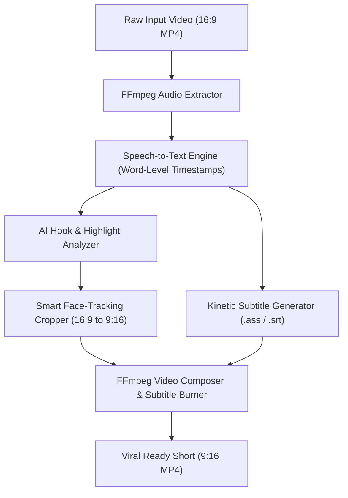

# ClipForge 🎬⚡

> **Open-Source AI Video Repurposing & Kinetic Caption Engine.**  
> Automatically turn long-form videos (podcasts, interviews, talks) into viral vertical shorts (9:16) with smart face-tracking and animated karaoke subtitles.

---

## 🌟 Why ClipForge?

Content creators and media teams spend hours manually clipping long videos, reframing them to vertical 9:16 for TikTok/Reels/Shorts, and keyframing subtitles. Commercial tools charge \$20–\$50/month for this.

**ClipForge** is a local-first, open-source pipeline that does it all in seconds:
1. 🎯 **Viral Hook Detection**: Analyzes transcript sentiment, hook density, and speech pace to isolate the most engaging 30–60 second segments.
2. 👤 **Smart Face-Centric Cropping**: Uses computer vision face detection to dynamically center speakers when converting landscape (16:9) to vertical (9:16).
3. ✨ **Kinetic Karaoke Subtitles**: Generates word-by-word highlighted captions with custom animations burned directly onto the video.
4. 🔒 **Local & Privacy-Preserving**: Runs directly on your machine with FFmpeg and local or cloud AI models.

---

## 🏗️ Architecture



---

## 🚀 Quickstart

### Prerequisites
- Python 3.10+
- [FFmpeg](https://ffmpeg.org/download.html) installed and available on PATH.

### Installation
```bash
git clone https://github.com/your-username/clipforge.git
cd clipforge
pip install -r requirements.txt
```

### Usage
#### Command Line Interface (CLI):
```bash
# Auto-detect top clips and render 9:16 short with subtitles
python -m clipforge.cli process sample.mp4 --min-duration 30 --max-duration 60 --subtitles

# Inspect transcript with word-level timestamps
python -m clipforge.cli transcribe sample.mp4
```

---

## 📦 Project Structure

```
clipforge/
├── clipforge/
│   ├── __init__.py
│   ├── cli.py             # Command-line interface
│   ├── core/
│   │   ├── media.py       # FFmpeg video/audio processing utilities
│   │   ├── transcriber.py # Audio transcription & timestamp alignment
│   │   ├── analyzer.py    # Highlight & viral score detection
│   │   ├── cropper.py     # Smart face-tracking & 9:16 reframing
│   │   └── subtitle.py    # Kinetic ASS/SRT subtitle generator
│   └── web/
│       └── app.py         # Lightweight interactive Web UI
├── tests/
├── requirements.txt
└── pyproject.toml
```

---

## 📄 License
MIT License.
